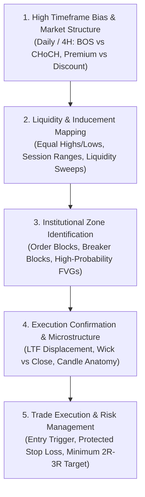

# Master Strategy Playbook: Institutional Smart Money Concepts & Price Action

This playbook synthesizes all **54 instructional videos** from the `imperial-research` archive into an integrated, institutional-grade trading curriculum and rulebook.

---

## Architecture of the Trading System

---

## Module 1: Market Structure & Directional Bias

### 1.1 BOS (Break of Structure) vs. CHoCH (Change of Character)
* **Trend Continuation (BOS):** Price breaks structural swing highs (in an uptrend) or swing lows (in a downtrend) with an aggressive **candle body close** (wicks do not qualify). Confirms trend health.
* **Trend Reversal Warning (CHoCH):** Price breaks and closes beyond the most recent counter-structural swing point (e.g., closing below the higher low in an uptrend, or above the lower high in a downtrend).
* **Failure Swings:** A swing high that fails to reach the previous high followed by a break below the prior low indicates buyer exhaustion before the CHoCH confirms.

### 1.2 Premium vs. Discount Framework (The 50% Equilibrium Rule)
* **Impulse Anchoring:** Anchor Fibonacci or range measurement from the swing low to swing high of the current trading range.
* **The 50% Equilibrium Divide:**
  * **Premium Zone (> 50%):** Favors short setups. Buying in Premium exposes the trader to institutional distribution.
  * **Discount Zone (< 50%):** Favors long setups. Shorting in Discount exposes the trader to institutional accumulation.
* **Golden Retracement (0.382 – 0.618):** High-probability zones for re-entering with the macro trend.

### 1.3 Multi-Timeframe Alignment (The Single-Job Rule)
* **4H / Daily:** Macro Trend & Key Support/Resistance / External Liquidity Pools.
* **1H:** Intraday Range, Session Extremes, Major Liquidity Sweeps.
* **15M:** Structural Transitions (CHoCH), Order Block & FVG Selection.
* **5M / 3M:** Precision Confirmation Trigger, Candlestick Rejection, Risk Compression.

---

## Module 2: Liquidity Architecture & Manipulation

### 2.1 The Liquidity Pools (BSL & SSL)
* **Buy-Side Liquidity (BSL):** Resting above double tops, equal highs (EQH), and major swing highs. Composed of retail stop-losses (buy orders) and retail breakout buy stops.
* **Sell-Side Liquidity (SSL):** Resting below double bottoms, equal lows (EQL), and major swing lows. Composed of retail stop-losses (sell orders) and breakdown sell stops.
* **Target First, Entry Second Axiom:** Smart money never enters without knowing where the opposing liquidity pool lies. The liquidity pool provides the fuel and exit liquidity for the trade.

### 2.2 Liquidity Sweeps vs. Authentic Breakouts
* **The "One Close Rule":**
  * **Wick Piercing:** Price pierces a level with a wick and closes back inside the range. This is a **Liquidity Sweep (Inducement / Stop Run)**.
  * **Body Close:** Price closes a full candle body beyond the level.
  * **3-Step Breakout Filter:**
    1. Candle close beyond the level.
    2. Next candle holds outside without immediately collapsing.
    3. Retest of the broken level rejects cleanly from the exterior.
  * **The Trap:** If price spikes past equal highs/lows and immediately closes back inside the range, it is an engineered trap designed to liquidate retail positions.

### 2.3 Session Liquidity Dynamics (London & New York Sessions)
* **London Opening Range:** Sets initial liquidity pools (London High & London Low).
* **New York Session Open (Judas Swing):** NY open frequently runs a sweep of either the London High or London Low to capture liquidity, quickly printing an M15/M5 CHoCH back inside the range, targeting the opposite London session extreme.
* **Gold 15-Minute Opening Range Breakout (ORB):** Align the 9:30 AM NY 15-minute high/low with the 4H trend. Wait for a 5M body close outside the range in the direction of the HTF trend; cancel setup if price closes back inside.

---

## Module 3: Institutional Imbalances & Order Blocks

### 3.1 Fair Value Gaps (FVG) Anatomy & Hierarchy
* **3-Candle Structure:**
  * BISI (Bullish): Candle 1 High does not touch Candle 3 Low, leaving an open imbalance across Candle 2.
  * SIBI (Bearish): Candle 1 Low does not touch Candle 3 High.
* **Consequent Encroachment (C.E. 50%):** The midpoint of the FVG. Institutional algorithms frequently respect the 50% level. A candle body close beyond 50% or beyond the far boundary invalidates the gap.
* **Breakaway Gap vs. Retrace Gap:**
  * If Candle 3 closes back within the range of Candle 2, it is a standard FVG that will retrace to fill.
  * If Candle 3 closes *beyond* the extreme of Candle 2, it indicates overwhelming institutional displacement (Breakaway Gap) and price will not retrace.
* **Statistical Reality of FVGs:** While 92% of FVGs are eventually filled within 24 hours, price also travels an equal distance in the opposite direction (Mirror Level) 92.5% of the time. **An FVG alone is not a reason to trade toward it**; it is only a high-probability entry when aligned with trend and liquidity sweeps.

### 3.2 The Order Block (OB) Validation Checklist (5 Mandatory Checks)
1. **Liquidity Sweep:** The Order Block candle must have swept prior swing highs or lows.
2. **Displacement & Imbalance:** The move out of the candle must create a clear Fair Value Gap (FVG). "No FVG = No Order Block."
3. **Structure Shift:** The displacement must break structure with a clean candle body close (CHoCH or BOS).
4. **Unmitigated Status:** The zone must remain virgin/untouched until the retest.
5. **Rejection Trigger:** Price must show clear rejection wicks or lower-timeframe confirmation when tapping the Order Block.

### 3.3 Breaker Blocks vs. Order Blocks
* **Order Block:** The last opposing candle before an impulse that continues in the direction of the trend.
* **Breaker Block:** An Order Block that previously failed because price ran through it during a liquidity sweep, which then flips polarity (support becomes resistance, resistance becomes support).

---

## Module 4: Candlestick Microstructure & Internal Decomposition

### 4.1 Deconstructing 1H Candles into Lower Timeframe Reality
* **1 H1 Candle = Four 15-Minute Candles (or Twelve 5-Minute Candles):**
  * Three visually identical H1 Shooting Stars or Hammers have vastly different internal mechanics.
  * **Low-Probability Candle:** Price drifts slowly up and slowly down inside the candle, sweeping no liquidity and breaking no structure ("Empty Inside").
  * **High-Probability Candle:** Price sweeps equal highs/lows on M15, triggers stop losses, aggressively displaces with an FVG, and prints an internal M15 CHoCH before closing.

### 4.2 Real Displacement vs. Corrective Grinds
* **Displacement Signatures:** Large expansion candle bodies closing near their extremes, consecutive directional bars, and creation of an open FVG.
* **Exhaustion Clues (Buyers/Sellers Are Tired):** Shrinking candle bodies, expanding rejection wicks, loss of momentum on RSI/Delta, and failure to create new FVGs.

### 4.3 Key Reversal & Continuation Patterns
* **Reversal Formations:**
  * **Bearish/Bullish Engulfing:** Validated only when engulfing candle displaces through an active liquidity level and leaves an FVG.
  * **Tweezer Tops / Bottoms:** Equal high/low defense showing immediate rejection at key institutional supply/demand.
  * **Morning Star / Evening Star:** 3-phase cycle: strong trend candle -> indecision star/doji at liquidity sweep -> displacement confirmation.
  * **Head & Shoulders / Inverse H&S / Double Tops:** Always require a decisive candle body close below the neckline before entering on the retest.
* **Continuation Formations:**
  * **Rising / Falling Three Methods & Mat Holds:** Shallow pullbacks (holding within the first candle's range) showing that counter-trend volume is negligible before resumption.

---

## Module 5: Standardized Trade Execution Protocols

### Protocol A: The Classic Liquidity Sweep Reversal (SMC 5-Step)
1. **Bias & Zone:** Price enters HTF Premium (> 50%) for sells, or Discount (< 50%) for buys.
2. **Liquidity Engineering:** Equal highs / equal lows formed during the consolidation.
3. **The Sweep (Inducement):** Rapid spike wicks beyond the equal highs/lows, triggering stop orders.
4. **Displacement & CHoCH:** Aggressive impulse in the reverse direction closing a candle body beyond the recent counter-swing and creating an FVG.
5. **Mitigation Entry:** Limit or market entry on the tap into the unmitigated Order Block or FVG.
* **Stop Loss:** 2–5 ticks beyond the extreme sweep wick.
* **Invalidation:** Candle body close beyond the sweep extreme.
* **Target:** Opposite structural liquidity pool / 50% equilibrium level (Minimum 2R to 3R).

### Protocol B: "Target First, Entry Second" (Equal Highs/Lows + FVG)
1. **Identify Opposing Magnet:** Mark resting BSL (Equal Highs) or SSL (Equal Lows).
2. **Deep Retracement & Displacement:** Price drops far into discount and violently rebounds with an FVG.
3. **Retest Tap:** Enter long when price dips back into the FVG.
* **Stop Loss:** Protected just beneath the swing low that originated the FVG.
* **Invalidation:** Candle body close below the originating swing low.
* **Target:** Equal Highs liquidity pool (guaranteed asymmetric R:R).

### Protocol C: The NY Session Sweep & Reversal
1. **Mark Session Extremes:** Record the High and Low of the London trading session.
2. **Opening Sweep:** During NY open (8:30 AM – 10:00 AM EST), price wicks beyond London High or Low.
3. **Re-entry Confirmation:** Wait for an M5 or M15 candle body to close back *inside* the London range.
4. **Trigger:** Enter on the subsequent mitigation tap into the NY opening FVG/OB.
* **Stop Loss:** Above/below the NY sweep extreme.
* **Target:** Opposite London session extreme (e.g., London Low if London High was swept).

---

## Universal Golden Rules & Traps to Avoid

1. **"Wicks do the damage; Bodies tell the story."** Never trade a breakout on a wick piercing. Require a full candle body close.
2. **"No FVG = No Displacement = No Valid Order Block."** If an impulse move does not leave an imbalance, institutional participation is lacking.
3. **"Never trade toward an FVG in isolation."** An FVG is a discount/premium zone for execution, not an autonomous price target.
4. **"Inducement is the retail trap before the true zone."** The first minor pullback high/low is designed to bait early retail entries. Let them get stopped out into the genuine Order Block before entering.
5. **"One clue is not a signal. Confluence is your edge."** High-win-rate trades require the intersection of: (1) HTF Trend/Bias, (2) Liquidity Sweep, (3) Market Structure Shift (CHoCH), and (4) Institutional Imbalance/OB.
