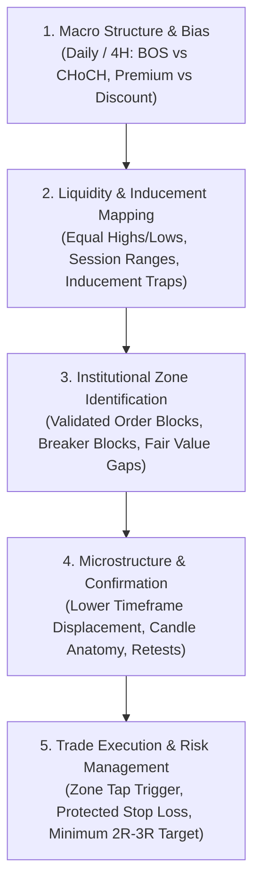

# Institutional SMC & Price Action Trading Playbook

An institutional price action research library and systematic strategy playbook covering Smart Money Concepts (SMC), market structure, institutional liquidity architecture, order blocks, and execution mechanics.

---

## Architecture Overview

---

## Core Frameworks

### 1. Market Structure & Directional Bias
* **Break of Structure (BOS):** Confirms trend continuation. Requires a full **candle body close** beyond structural swing extremes; wicks represent testing and liquidity consumption rather than structural breaks.
* **Change of Character (CHoCH):** First structural warning of potential trend reversal. Occurs when price breaks and closes beyond the counter-trend swing high or low.
* **Premium vs. Discount (50% Equilibrium Rule):**
  * **Premium Zone (> 50%):** Favored for short entries; buying in premium carries heightened distribution risk.
  * **Discount Zone (< 50%):** Favored for long entries; shorting in discount carries accumulation risk.

### 2. Liquidity Architecture
* **Buy-Side Liquidity (BSL) & Sell-Side Liquidity (SSL):** Stop orders resting above equal highs and below equal lows.
* **Target First, Entry Second:** High-probability setups identify the target liquidity pool before locating an entry mechanism.
* **Liquidity Sweeps (Stop Runs):** Rapid wicks beyond structural levels that immediately close back within the range, capturing resting orders before reversing.

### 3. Institutional Zones & Imbalances
* **Order Blocks (OB):** Supply and demand zones identified as the final candle before a displacement impulse that breaks structure and leaves an open imbalance.
* **Fair Value Gaps (FVG):** 3-candle price imbalances where Candle 1 and Candle 3 wicks do not overlap, leaving an inefficient void.
* **Consequent Encroachment (C.E. 50%):** The midpoint of an imbalance zone. Candle body closes beyond 50% or the opposing boundary signal zone invalidation.

---

## Execution Models

### Setup 1: Liquidity Sweep Reversal
1. Identify major impulse and verify price is in Premium (for shorts) or Discount (for longs).
2. Wait for market structure shift (CHoCH) on the intermediate timeframe.
3. Observe liquidity engineering (equal highs / equal lows).
4. Monitor liquidity sweep that triggers stops and taps into an unmitigated Order Block.
5. Enter on confirmation close back within the range; stop loss placed beyond the sweep wick; target opposing liquidity pool.

### Setup 2: Imbalance Retest Continuation
1. Mark the target liquidity pool (e.g. resting stops above equal highs).
2. Wait for strong displacement leaving an open Fair Value Gap.
3. Enter on retracement tap into the FVG; stop loss placed behind the displacement swing low.
4. Target the confirmed liquidity pool for minimum 2R reward.

---

## Repository Contents

* `MASTER_STRATEGY_PLAYBOOK.md`: Comprehensive rulebook and trading curriculum.
* `MASTER_INDEX.md`: Catalog of all individual strategy analyses.
* `analysis/`: 54 structured strategy teardowns detailing concept mechanics, execution plans, and invalidation rules.
* `tools/`: Utility scripts for dataset verification and index generation.

---

## License

MIT License.
